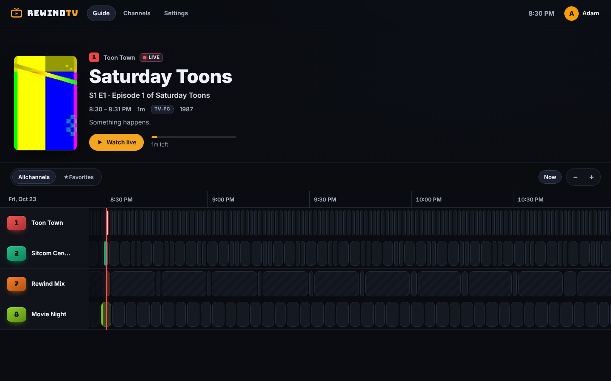
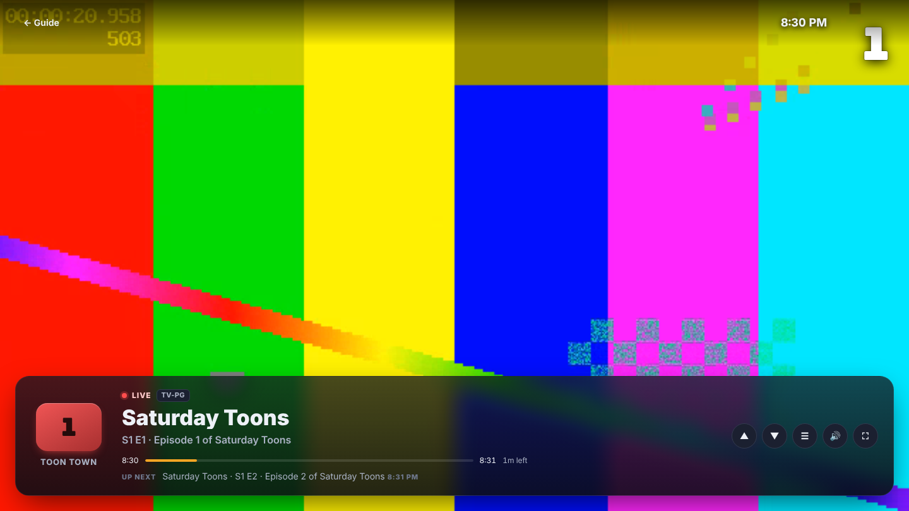
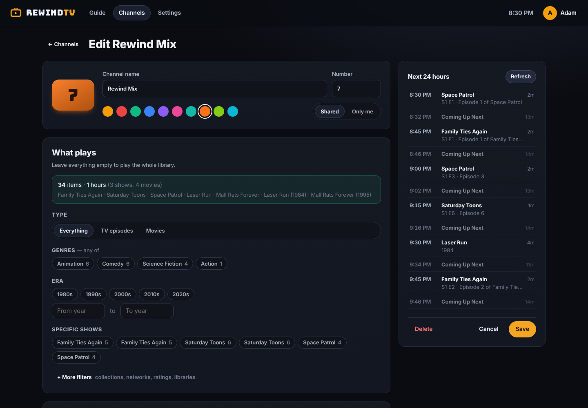
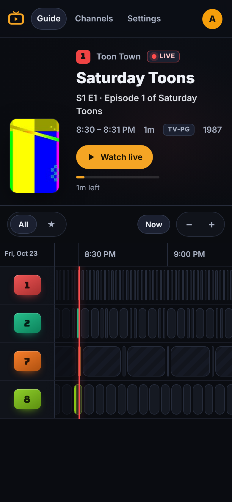

# RewindTV

Turn your **Plex** and **Jellyfin** libraries into old-school live TV channels. Shows air on a schedule, you tune in mid-episode, and there's a real TV guide. It's a self-hosted take on the Nostalgia TV idea, built to run as a single Docker container on TrueNAS SCALE or anything else that runs Docker.

<p align="center">
  
  
</p>
<p align="center">
  
  
</p>

*(Screenshots use generated test clips; your own posters and backdrops fill the guide's hero and channel cards.)*

## Features

- **Plex and Jellyfin, together.** Connect any number of servers. Channels can mix libraries from both.
- **Real live TV.** Each channel has a 7-day schedule generated on the server, so every TV in the house shows the same thing at the same moment. Tuning in starts mid-show, at exactly where "live" is.
- **TV guide.** A scrolling program grid with a now line, a live progress bar on each channel and poster/backdrop previews. It works with mouse, touch, keyboard or a TV remote's D-pad.
- **Full-screen TV mode.**
  - Channel up/down with arrow keys, PgUp/PgDn or swipes.
  - Type a channel number like a real remote.
  - An info banner shows what's on and what's up next.
  - A quick channel list (`G`), last channel (`L`), and a burst of analog static when you change channels.
- **Channel builder.**
  - Filter by genre, decade/year, specific shows, collections, networks/studios, ratings and libraries.
  - A live "matches N items / H hours" counter updates as you go.
  - A 24-hour schedule preview shows what will air before you save.
- **Four ways to program a channel:**
  - *Shuffle*: everything airs before anything repeats.
  - *Rotation*: one episode per show, each show in order.
  - *Blocks*: N episodes of one show, then the next show.
  - *Marathon*: whole series back-to-back.
- **Time-of-day blocks.** Saturday-morning cartoons, prime-time sitcoms, late-night movies. A weekly timeline shows the layout, and blocks start on time.
- **Auto-create.** Build channels in one click from your genres, decades, collections, studios, or "Show 24/7" marathons.
- **Profiles.** A Netflix-style "Who's watching?" screen. Each profile gets its own favorites, hidden channels and private channels; shared channels show for everyone. There are no passwords, since this is meant for your home network.
- **Watch in Plex.** RewindTV acts as an HDHomeRun tuner, so your channels appear in Plex's Live TV guide on every Plex app. Your Plex server converts every show to the same format, so mixed libraries flip between shows without hiccups.
- **Watch anywhere else.** Every profile gets an M3U playlist and an XMLTV guide for **Jellyfin Live TV**, TiviMate, VLC and similar apps.
- **Skip intros and credits per channel.** Uses Plex's markers, markers you set (per season or episode), and RewindTV's own audio-based detection. Markers are saved per show in their own folder and apply on every server.
- **Sign in with Plex and a built-in check.** Sign in with Plex instead of hunting for a token. A one-click check tests every playback path on your real server.
- **Light on your NAS.** Browser playback uses your media server's own transcoder, including hardware acceleration if you have it. RewindTV proxies the stream, so server tokens never reach the browser. Abandoned streams are stopped automatically when someone channel-surfs.

## Install on TrueNAS SCALE

These steps are for TrueNAS SCALE 24.10 "Electric Eel" or newer.

1. **Create a dataset** for the app's data, for example `tank/apps/rewindtv`.
2. Go to **Apps → Discover Apps → ⋮ (top right) → Install via YAML**.
3. Paste [`truenas/rewindtv.yaml`](truenas/rewindtv.yaml). Change the host path to your dataset and `TZ` to your time zone.
4. Open `http://<truenas-ip>:8420`, create a profile, then go to **Settings → Add server**.

> **Private repository note:** GitHub publishes the image to `ghcr.io/adam-hollister/rewindtv`. If this repository is private, the package is private too, and TrueNAS can't pull it without credentials. You have two options:
> - Make the package public: on GitHub, go to **your profile → Packages → rewindtv → Package settings → Change visibility**.
> - Or add a GHCR credential in TrueNAS: **Apps → Configuration → Manage Container Image Registries**. Use your GitHub username and a personal access token with the `read:packages` scope.

### Docker Compose (any host)

```sh
docker compose up -d   # uses docker-compose.yml in this repo
```

## Connecting your media servers

**Plex:** go to **Settings → Add server → Sign in with Plex**.
1. Enter the 4-character code at [plex.tv/link](https://plex.tv/link).
2. Pick your server. RewindTV tests each of its addresses and uses the best local one.

If you'd rather paste a token: open any item in Plex Web → **⋯ → Get Info → View XML**, and copy the `X-Plex-Token=` value from the URL.

**Jellyfin:** use your server URL (e.g. `http://192.168.1.10:8096`) and an API key from **Dashboard → API Keys → +**.

Libraries sync on startup and every 6 hours. **Settings → Sync now** syncs immediately, and you can switch individual libraries off.

**Settings → Run check** tests a server end to end against a real item from your library:
- connection and library sync
- artwork
- browser playback
- the Live TV transcode
- direct file access

If anything fails, **Copy report** gives you the exact error to share.

## Watching in Plex (Live TV)

RewindTV presents itself to Plex as an **HDHomeRun tuner**, so your channels show up in Plex's Live TV guide on every Plex app. This requires Plex Pass.

1. In Plex Web open **Settings → Live TV & DVR → Set Up Plex DVR**.
2. If RewindTV isn't found automatically, choose *enter its network address manually* and type `<truenas-ip>:8420`.
3. At the guide step choose **“Have an XMLTV guide on your server? Click here to use that instead”** and enter `http://<truenas-ip>:8420/iptv/0/xmltv.xml`.
4. Plex matches channels by number; confirm and finish. After adding or renumbering channels in RewindTV, run **Scan channels** on the tuner in Plex.

How the Plex tuner works:
- **Uniform video.** Every program is converted *by your Plex server* to the same 1080p H.264 + stereo AAC, using Plex Pass hardware acceleration when your server has it. A library mixing HEVC, H.264, 5.1 audio and so on still plays as one smooth channel. RewindTV itself only stitches programs together, so it uses almost no CPU.
- **No stalls between shows.** The next program's transcode starts a few seconds early, and timestamps are rewritten so shows join seamlessly.
- **What Plex sees.** The tuner advertises 6 tuners (`REWINDTV_TUNERS`) and exposes the shared channels (`REWINDTV_HDHR_PROFILE=<id>` picks a profile instead). The XMLTV guide covers 7 days.
- **Automatic discovery.** Plex finds RewindTV on the network via HDHomeRun discovery (UDP 65001). This only works with host networking; see the TrueNAS YAML. With the default bridge network, use the manual address in step 2.

## Skipping intros and credits

Turn on **Skip intros** and/or **Skip credits** per channel in the channel editor. It's handy for anime and binge channels. Skipping is part of the schedule:
- The guide shows each episode's real, shorter run time.
- Plex Live TV gets a clean cut over the theme song.
- The browser player jumps the gaps.
- Only the credits themselves are cut, so post-credit scenes still play.

**Where markers come from.** Pick the sources in **Settings → Intros & credits**. When several exist, the highest one on this list wins:
1. **Your markers.** The marker editor has a page per show (open it from Settings → Intros & credits → Shows), where you can set:
   - Season rules like "intro 1:32–3:02" or "credits = the last 1:30 of each episode".
   - Single-episode overrides. **Preview** plays the episode so you can press *Mark start* / *Mark end* at the exact moment.
2. **Plex / Jellyfin.**
   - Plex: Plex Pass detects intros and credits. Turn on *Generate intro video markers* and *Generate credits video markers* in Plex's library settings.
   - Jellyfin: needs a media-segments plugin such as Intro Skipper.
   - RewindTV picks these up on every sync, and re-checks weekly while Plex finishes analysing.
3. **Auto-detect.** RewindTV compares the audio of episodes in a season and finds the theme song and credits they share.
   - It only scans shows on channels that skip something, one file at a time, and caches its work.
   - It reads files through your media server, or from your media folder if you mount it read-only and set `REWINDTV_PATH_MAP`.

**Markers are saved per show, not per server.**
- They're tied to the episode itself: show + season + episode, or title + year for movies, plus TVDB/TMDB/IMDb IDs. They are not tied to a server's internal ID, so markers set once apply on Plex, Jellyfin, a rebuilt server or a second RewindTV install.
- If a file's length differs slightly between servers, credits stay matched to the end.
- They're stored as readable JSON in their own folder (`REWINDTV_MARKERS_DIR`, default `/data/markers`), one file per show, never next to your media. Your source choices are saved there too.
- RewindTV writes the files as markers change and reads the whole folder at startup and on every sync. Point a fresh install at the same folder and everything comes back.

## Other IPTV apps (Jellyfin Live TV, TiviMate, VLC)

**Settings → Other IPTV apps** lists two URLs per profile (profile `0` is the shared channels only):

- `http://<host>:8420/iptv/<profile>/playlist.m3u`
- `http://<host>:8420/iptv/<profile>/xmltv.xml`

For Jellyfin: **Dashboard → Live TV → Tuner devices → +** (M3U Tuner), then **TV guide data providers → XMLTV**.

## Remote / keyboard shortcuts (TV mode)

| Key | Action |
| --- | --- |
| ↑ / ↓, PgUp / PgDn, + / − | Channel up / down |
| 0–9 | Type a channel number |
| G | Channel list |
| L | Last channel |
| ← / → / I / Enter | Show info banner |
| M / F | Mute / fullscreen |
| Esc / Backspace | Back to the guide |

In the guide, arrows move between programs, Enter tunes in, and typing a number jumps straight to that channel.

## Configuration

| Variable | Default | Purpose |
| --- | --- | --- |
| `TZ` | `UTC` | Time zone for time-of-day blocks, alignment and the guide |
| `REWINDTV_DATA` | `/data` | Where the SQLite database lives |
| `REWINDTV_PORT` | `8420` | HTTP port |
| `REWINDTV_PUBLIC_URL` | *(from request)* | Base URL written into M3U/XMLTV links |
| `REWINDTV_IPTV_VIDEO` | `server` | Live TV/IPTV video. `server`: Plex/Jellyfin transcodes every program to identical 1080p H.264. `copy`: original files untouched, lowest CPU, but codec changes between shows can upset players. `h264`: RewindTV re-encodes with its own ffmpeg. |
| `REWINDTV_MARKERS_DIR` | `/data/markers` | Intro/credits marker files (one JSON per show); give it its own dataset to keep it across reinstalls |
| `REWINDTV_PATH_MAP` | *(none)* | `server_path=container_path;…` so auto-detect reads a read-only media mount directly |
| `REWINDTV_TUNERS` | `6` | Tuner count advertised to Plex (simultaneous channels) |
| `REWINDTV_SYNC_HOURS` | `6` | Library sync interval |
| `REWINDTV_HDHR_PROFILE` | `0` | Profile whose lineup the HDHomeRun tuner (for Plex) exposes; `0` = shared channels |

## How it works

- **Backend:** Rust (axum, sqlx/SQLite, reqwest), in `src/`.
  - `schedule/` holds the pure scheduling engine: filters, ordering cursors and time-of-day blocks. It's unit-tested, including DST transitions.
  - `media/` holds the Plex and Jellyfin clients.
  - `stream/` holds the HLS proxy and the IPTV muxer.
- **Frontend:** Svelte 5 + Vite, in `web/`. It's compiled into the binary, so the image is a single executable plus ffmpeg.
- **Guide:** Each channel keeps a rolling 7-day guide that is extended hourly. Editing a channel rebuilds its future schedule while the program on air keeps playing.

## Development

```sh
# backend (serves the API on :8420; uses ./data)
REWINDTV_DATA=./data TZ=America/Chicago cargo run

# frontend with hot reload on :5173 (proxies /api to :8420)
cd web && npm install && npm run dev

cargo test           # scheduler, filters, parsers, HLS rewriting, TS scanner
cd web && npm run check
```

Pushing to `main` runs the tests and publishes `ghcr.io/<owner>/rewindtv:latest`. Pushing a `v*` tag also publishes a version-tagged image.

## Credits

Inspired by [Nostalgiavision](https://github.com/nexusjuan12/Nostalgiavision) and the Nostalgia TV app.
